# Pelle TM1

Pelle TM1 is a full-featured Turbo Integrator Process and Rule Editor for TM1 Planning Analytics built on top of [Sublime Text 4](https://www.sublimetext.com)

## Features

### Direct TM1/Planning Analytics Integration

Pelle uses the TM1 REST API for a direct integration with your remote TM1 environment. There are commands to retrieve and push both rule and turbo integrator updates directly to the TM1 server, you can perform all code-intensive updates all from Pelle. 

You can also run Turbo Integrator processes right from Pelle, and see the run's own tm1server.log entries and TM1ProcessError files right away, in an output panel and in the sidebar. You can follow the server's message log live, too.

### Rule and Turbo Integrator Auto Complete

Pelle comes equipped with the full set of functions used in both Rules and Turbo Integrator. They can be easily accessed using Sublime's auto-complete features. Save time by letting Pelle auto-fill the appropriate parameters for a given function, and will even provide a link to the IBM documentation.

Pelle will help you build your complex rule DB() statements, and TI cellget/put/increment functions by populating the appropriate dimensions.

### Syntax Checking

Pelle will leverage the syntax checking features of the TM1 API to let you know on update if there are any issues with your rule or process. It highlights each line with an error, with TM1's message beside it.

### TI Process Auto Format

Pelle helps to ensure that all code in your TM1 environment has a consistent look and feel. It will automatically format your Turbo Integrator processes, ensuring they have consistent indentation, case, and whitespace. 

### Advanced Completions

Pelle has a bunch of built-in completions for common actions performed within TI processes. This includes:

- Creating views, zeroing out cubes, assigning as cube views as a datasource
- Dimension and hierarchy manipulation
- Iterating through files, cubes, dimensions, 
- Setting up different datasources like ASCII, ODBC, or Cube View

### TM1Top Thread Viewer and Killer

Easily view the current state of your TM1 server. See all the currently running threads, refreshed live, and stop a server thread right from Pelle.

### Signing In, However Your TM1 Is Secured

TM1's own security, CAM with a user and password, or CAM through single sign-on (OpenID Connect, SAML…) in a browser window. Pelle works out which from the server, and never stores your password.

## Installation

- Requires **Sublime Text 4 build 4213 or later** (its plugins run on Python 3.14). Earlier builds keep getting version 0.2.x.
- Install [Package Control](https://packagecontrol.io/installation) ([how to use it](https://packagecontrol.io/docs/usage)), then the 'TM1 Planning Analytics Developer Tools' package.
- Package Control also installs the libraries Pelle uses, among them [skipcheck-tm1](https://github.com/ajmyers/skipcheck-tm1), its TM1 REST API client. If a command says they're missing, run 'Package Control: Satisfy Libraries'.
- On the TM1 server, the REST API must be enabled, instructions [Here](https://www.ibm.com/support/knowledgecenter/en/SSD29G_2.0.0/com.ibm.swg.ba.cognos.tm1_inst.2.0.0.doc/t_ug_cxr_odata_config.html)
- For single sign-on through a browser window: a Chromium-based browser (Chrome, Edge, Brave or Chromium). Edge comes with Windows.

## Usage

### Setting up your project

First things first, we need to setup a Sublime Project for your TM1 environment.

- Open up Sublime Text so you have blank text input window
- Open up the Command Palette (CMD-SHIFT-P on mac, CTRL-SHIFT-P on windows) and enter 'tm1 config'.  
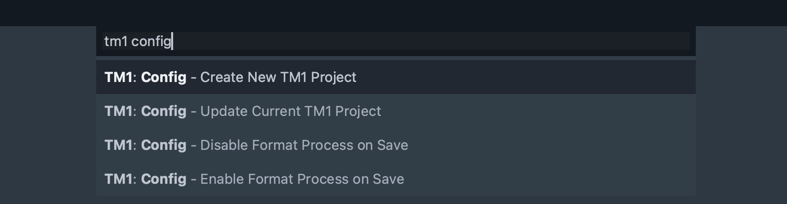 
- Select 'TM1: Config - Create New TM1 Project'
- Enter the TM1 server's **host name** (or a URL, such as `https://tm1.example.com:8010`, or IBM Cloud's `https://<company>.planning-analytics.ibmcloud.com/tm1/api/<server>`). Pelle works out the rest by asking the servers, without logging in:
  - the TM1 servers on that host, from its Admin Server, to pick from (or it asks for the port);
  - HTTPS or HTTP (if the certificate isn't trusted, often IBM's self-signed one, it asks whether to connect anyway);
  - how to log in: TM1's own security, or CAM, with Cognos's namespaces to pick from.
- It asks only what it can't find: your user name (not for single sign-on), and the project's name and folder.

The project opens in a new window, with a Sidebar containing its .sublime-project file

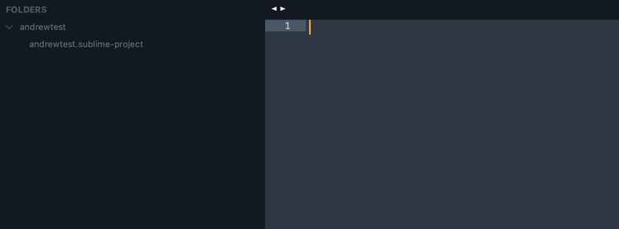

'TM1: Config - Update Current TM1 Project' runs the same steps for the open project.

### Signing in

- **Your password is never stored.** Pelle asks for it the first time a project connects, and keeps it in memory until Sublime closes, TM1 refuses it, or you run 'TM1: Config - Sign Out'.
- **Single sign-on:** for a Cognos namespace that signs in through a browser (OpenID Connect with Entra ID, Okta, Keycloak…, SAML), Pelle opens a small browser window on Cognos's own login page. Sign in as you would for Planning Analytics Workspace, and the window closes by itself. It uses a browser profile of its own, never yours, so your identity provider may remember you and later sign-ins can need no window at all.
- If the browser can't be used (none installed, or your organisation's browser policy blocks it), Pelle says why and offers to sign in with a user and password instead, or to paste a CAM passport (the `cam_passport` cookie from a browser signed in to Cognos).
- Settings, under `"tm1"` in the project's settings, for when the defaults don't fit:
  - `"auth"`: `"basic"`, `"cam"` (a user and password) or `"browser"`, instead of working it out;
  - `"verify"`: `false` not to check TM1's certificate, or the path of a CA bundle that signs it;
  - `"dispatcher"`: Cognos's address, when the one TM1 gives isn't reachable from your computer.
- In Preferences > Package Settings > TM1, `"browser"` sets the browser to sign in with.

### Populate Rules and Processes from Remote Server

- Open the command palette, and enter 'tm1 get'  
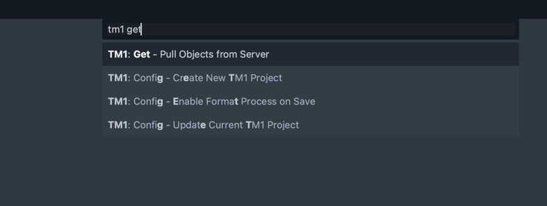
- Select 'TM1: Get - Pull Objects From Server'. This will connect to the remote server and pull all Rules and Process files. They will be placed in sub-folders within your project   
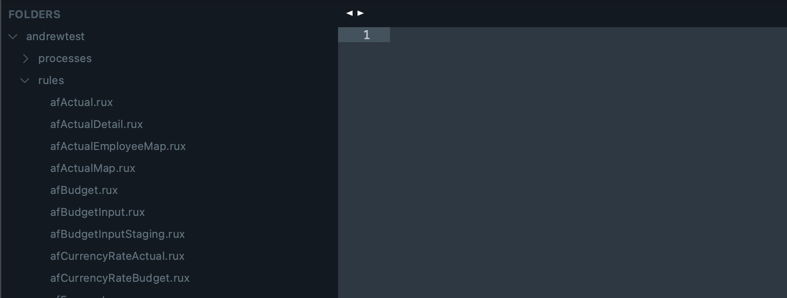

### Edit Rules and Processes

- To edit rules and processes, simply open the file in the sidebar and make your changes.
- To push the changes to the remote TM1 server: 
- Ensure the rule or process you want to push is the open, and active tab
- Open the command palette, and enter 'tm1 put'. Select 'TM1: Put - Push Object to Server'  
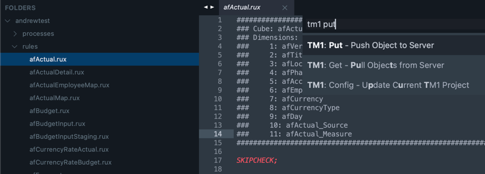
- This will update the rule or TI process on the server (a process that doesn't exist yet is created), then check it.
- If there are syntax issues, each line with an error is highlighted, with TM1's message beside it.  
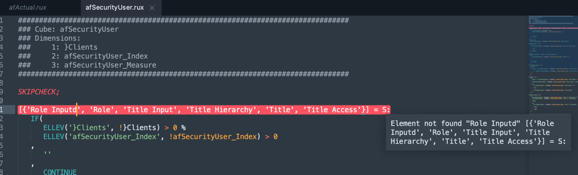

### Execute a TI Process

To execute a TI process:

- Open the command palette, and enter 'tm1 run'. Select 'TM1: Run - Execute Turbo Integrator Process'  
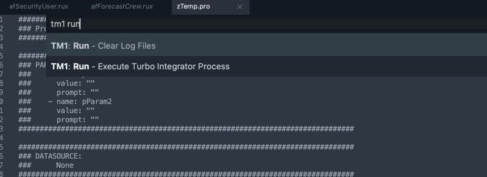
- The currently open TI process will be selected automatically, you can change the name of the process you want to execute.
- If there are any parameters in the TI process, you will be prompted to input the parameters
- Finally, you will be asked to confirm that the parameters are correct  
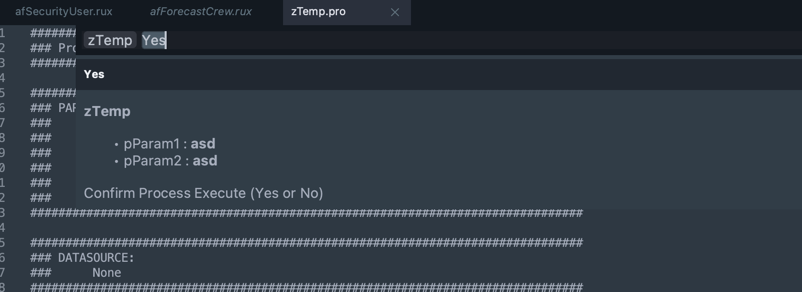

The process will execute in the background, and its status, its own tm1server.log lines and any TM1ProcessError files appear in an output panel when it's done.

You will see a new folder created in the side bar called 'Turbo Integrator Logs'. With a subfolder created for every TI process execution.

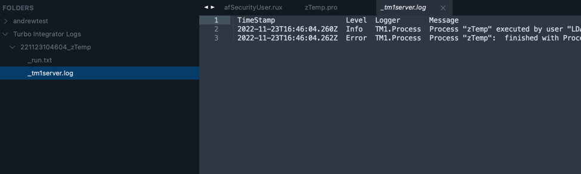

Within these folders, you can access the relevant tm1server.log lines, as well as any TM1ProcessError files that were created during process execution

You can clear all created log files using the command palette.

### TM1 Console

You can view all of the running threads on a TM1 server using the 'tm1 console' options from the command palette:

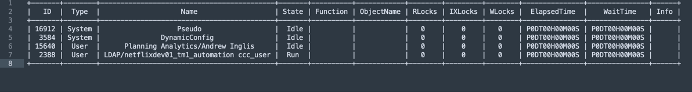

The console refreshes every few seconds while it's open (set `"ConsoleRefreshTime"`, in seconds, in the project's settings).

You can kill a running thread with the 'kill thread' option in the command palette: pick it from the list of running threads.

'TM1: Console - Tail Server Log' follows the server's message log in an output panel, as it's written.

### Turbo Integrator Rule Auto-Format

There are a couple ways to auto-format your processes. On demand, or On save. These options can all be accessed in the command palette with the command 'tm1 format'

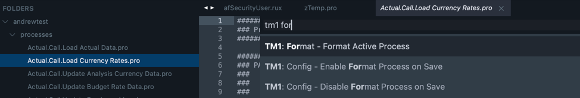

If you enable auto-formatting, the TI process will be formatted automatically when you save the file. Formatting changes only the code of the Prolog, Metadata, Data and Epilog: nothing else in the file.

### Completions

There are a handful of completions automatically built-in. 

### CELLGETN/CELLGETS/CELLINCREMENTN

Completions will automatically be created for all cubes. You can tab through each of the fields to make changes:

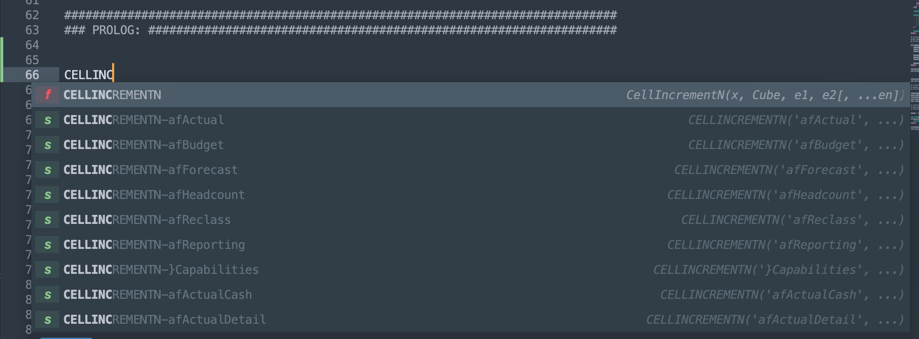

#### EXECUTEPROCESS

Same with EXECUTEPROCESS

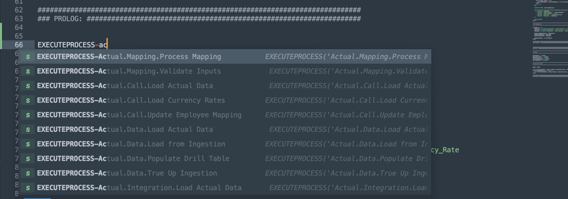

#### Locals

You can generate a 'Locals' section for metadata/data sections based on existing cubes

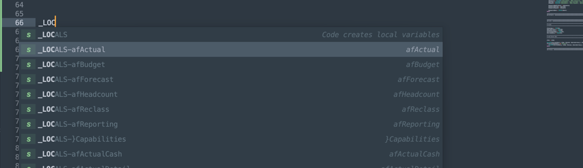

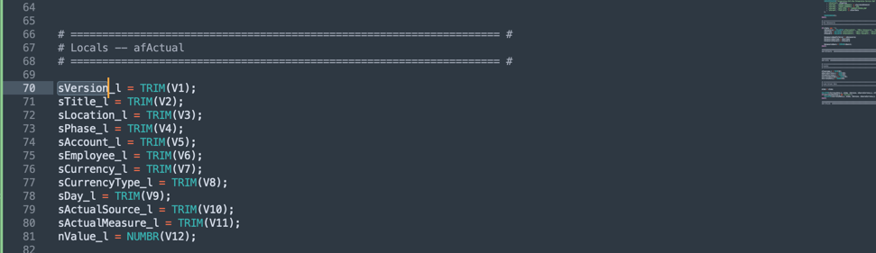

#### Templates

You can generate editable blocks for various types of datasources and other process properties:

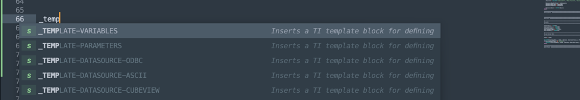

#### Auto-Complete

All Rule and Turbo Integrator functions should have auto-complete options available. You can also click to be taken directly to the IBM documentation for a given function. Just click the 'Documentation' link in the window.

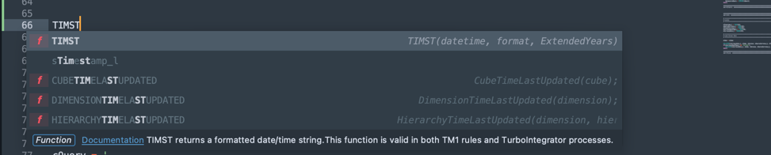

#### Snippets

Multiple snippets have been created for common TI process actions like creating views and iterating elements. You can access these snippets via underscore:

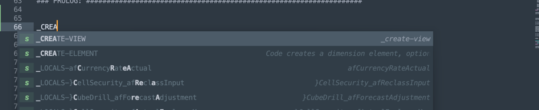

You can see the full list of snippets [here](https://github.com/ajmyers/Sublime-TM1/tree/master/snippets)

You can tab through each of the relevant fields to make wholesales changes to variable names (and more)

## Upgrading from 0.2.x

Your projects keep working as they are: their settings, files and commands, and your keybindings.

- The password stored in the project (obfuscated, not encrypted) is no longer used: Pelle asks for it once per session instead. 'TM1: Config - Update Current TM1 Project' offers to remove it from the project.
- Projects from 0.2.x keep logging in as they did. Projects set up or updated with this version work out how to log in, single sign-on included.
- Completions generated by 'TM1: Get' are no longer written into the project file. The ones 0.2.x wrote there are removed on the next Get, and your own stay.

## Contributing

Pull requests are welcome. For major changes, please open an issue first to discuss what you would like to change.

### Development

- Symlink the repository into Sublime's `Packages` folder as `TM1 Planning Analytics Developer Tools`, so changes reload as you save.
- The libraries come from Package Control. Until skipcheck-tm1 has a release in its default channel, `python3 tools/local_channel.py <folder>` builds a local channel with it: add the repository it prints to Package Control's `"repositories"`, and run 'Package Control: Satisfy Libraries'.
- Tests run outside Sublime, on Python 3.14: `pip install -r tests/requirements.txt`, then `pytest` and `ruff check core plugin tools tests`. `core/` is the code that doesn't need Sublime; `plugin/` is the Sublime side.
- The tests in `tests/live` run against a real TM1 when `TM1_URL` (with `TM1_USER`, `TM1_PASSWORD`) is set, and the CAM and browser ones with `TM1_CAM_URL`, `CAM_NAMESPACE`, `CAM_USER`, `CAM_PASSWORD` and `COGNOS_URL`. [skipcheck-tm1's `pa-setup`](https://github.com/ajmyers/skipcheck-tm1/tree/master/docker/pa-setup) starts TM1 with IBM's SData sample, Cognos and Keycloak locally, from your own licensed IBM downloads.
- `.github/project-entry.json` is this package's card on [skipcheck.io](https://skipcheck.io) and [ajmyers.net](https://ajmyers.net): its summary, links and the editor shown beside it. Publishing a release publishes it, with the release's version (`.github/workflows/project.yml`); to change the card between releases, run that workflow by hand.

## License

[GNU General Public License v3.0](https://choosealicense.com/licenses/gpl-3.0/)
